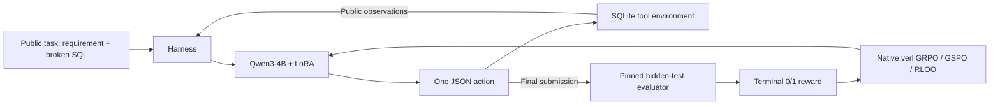

# SQLForge

**Feedback-driven SQL repair agents with verl, LoRA, and bounded harness search.**

SQLForge gives Qwen3-4B a natural-language requirement, a broken SQL query, and a SQLite database. The agent can inspect the schema, execute queries, and submit a repair within four actions. A pinned BIRD-RL evaluator supplies a binary terminal reward.

The released project covers three completed components:

- **Agentic RL:** native GRPO, GSPO, and RLOO in verl, connected through a custom SQL AgentLoop and action-token loss masks.
- **Agent harness:** configurable prompt guidance, feedback presentation, and history/state handling, with bounded LLM-assisted development search.
- **Evaluation:** frozen model identities, database-disjoint splits, public candidate selection, per-task outcomes, and explicit scoring exceptions.

## Results

Qwen3-4B-Instruct-2507, BF16 LoRA (rank 16/alpha 32), H0 harness. Each RL method uses the same 256 training tasks with 4 trajectories per task (1,024/method; 3,072 total). No project-specific SFT warm start. Evaluation temperature is 0.7; training temperature is 1.0.

| Model | Dev /128 | Test /128 | Test accuracy | New successes / lost successes vs Raw |
|---|---:|---:|---:|---:|
| Raw Qwen |41|39|30.47%|—|
| GRPO |46|39|30.47%|3 /3|
| GSPO |45|38*|29.69%|2 /3|
| RLOO |42|42|32.81%|3 /0|

RLOO gains 3 test tasks (+2.34 percentage points) in this **single-training-seed** experiment. This is a project-specific SIX-GYM-SQLite subset, not a full benchmark leaderboard result or evidence of a statistically established gain. Methods match rollout budgets but use different optimization epochs.

*One task required a disclosed scoring-copy index after the hidden evaluator timed out. The final comparison applies this treatment consistently to all four models. See [results and limitations](docs/results.md).*

Harness search evaluated 8 candidates around frozen GRPO weights. The best search candidate scored 28/64 versus H0’s 25/64, but failed the separate 64-task, two-sampling-seed selection rule. **H0 was retained.** The search produced 1,024 new development trajectories and no new test generations. [Harness protocol](docs/harness.md)

## Quick check: no GPU or API key

Python 3.11+ is required. The recorded GPU stack uses Linux/Python 3.12.

```bash
python3.12 -m venv .venv
source .venv/bin/activate
python -m pip install -e '.[dev]'
python -m unittest discover -s tests -v
python scripts/verify_results.py
```

SQLite fixtures in `tests/fixtures.py` exist only for integration tests. Their scores are not experimental results.

## Run the experiments

1. Install the pinned GPU stack and fetch verl/BIRD-RL: [setup](docs/setup.md).
2. Obtain the upstream dataset and databases, then import the frozen task IDs and audit: [data contract](data/README.md).
3. Prepare one common initialization, train the three native objectives, freeze adapters and evaluate: [reproduction](docs/reproduction.md).
4. Search harnesses on development tasks and freeze the selected configuration before explicit test evaluation: [harness workflow](docs/harness.md).

The public entry points remove historical server paths and artifact dependencies. Core environment, loss-mask integration, inference seeding, and selection rules derive from the completed runs. CPU tests validate this packaging; no new GPU training was run for the publication cleanup. Exact historical evidence and source hashes are in `results/`.

## Layout

```text
src/sqlforge/   SQL environment, evaluator, AgentLoop, harness, inference
scripts/       preparation, native verl training, evaluation, harness search
configs/       frozen RL protocol and declarative harness candidates
results/       aggregate results, task IDs, paired test outcomes, provenance
requirements/  recorded GPU package versions
tests/         CPU integration and regression checks
docs/          setup, architecture, reproduction, result interpretation
```

This release excludes early demonstration-generation/SFT pipelines, datasets, databases, model weights, checkpoints, server backups, personal resumes, and credentials. Downloaded upstream components retain their own licenses; see [attribution](docs/references.md).

## Architecture



Tool observations and chat boundaries have zero policy-loss mask. The evaluator never supplies reference SQL or hidden tests to the policy. SQL restrictions and independent database copies do not constitute an OS sandbox for untrusted benchmark Python code.
